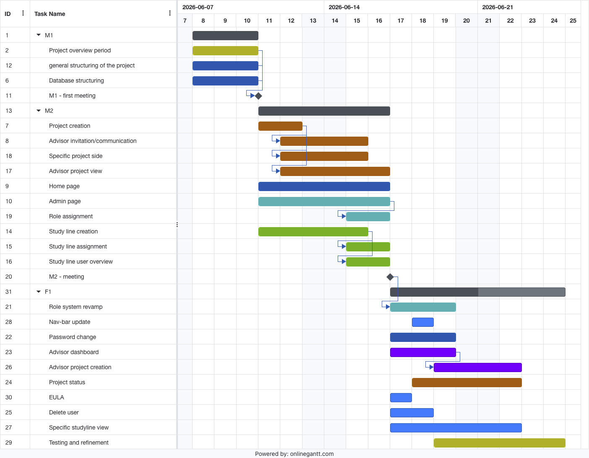
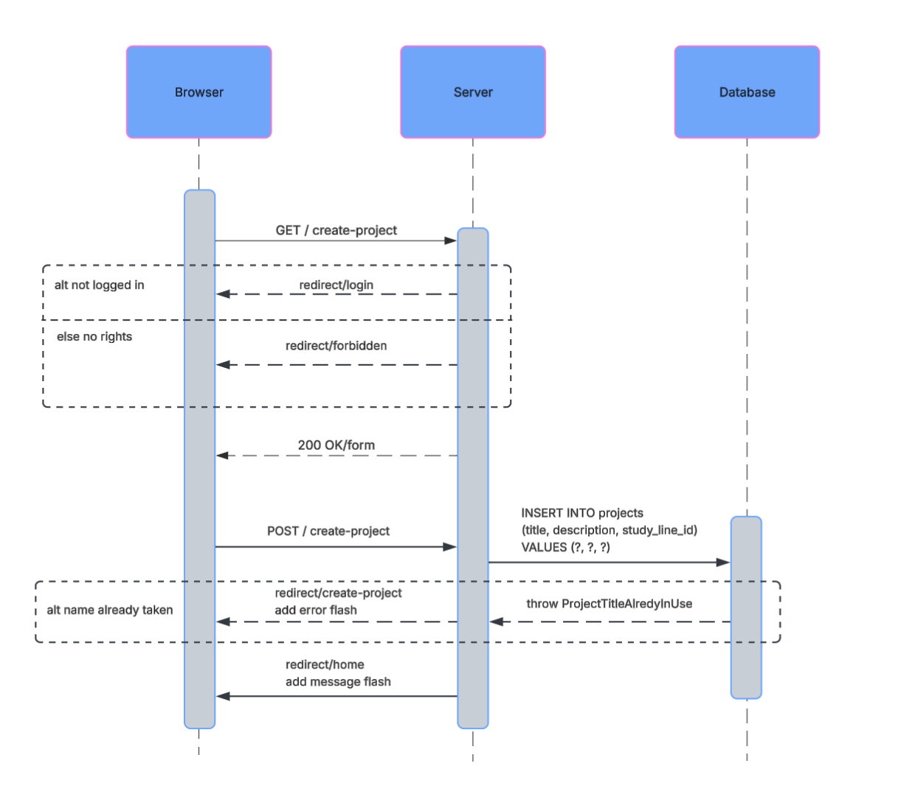
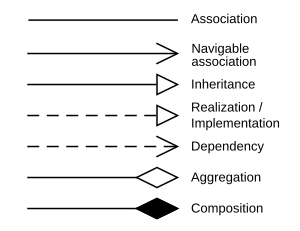

# Rapport

Dette er en vejledende og løs beskrivelse af, hvad der skal være i en god rapport.

**Rapportens opgave er at være et spejl af jeres produkt.**
Formålet ved rapporten er derfor til dels at sælge hvad I har lavet så godt som muligt.

De følgende sektioner er opdelt lidt ligesom en rapport ville være.

### Indledning

> _Hvem, Hvorfor, og Hvordan skal man læse rapporten?_

Kort sagt, har indledningen formålet at sætte kontekst og forventningerne til resten af rapporten.
En dårlig indledning giver derfor ofte et dårlig indtryk; som I så skal kæmpe jer tilbage fra i resten af rapporten.

Ting der er gode at få med:

- [ ] Sæt rapporten in kontekst. Hvad forventer I at jeres læser kan forstå?
- [ ] En kort beskrivelse af hvad I har lavet og er specielt stolte af, gerne med referencer til resten af rapporten.

### Kravsanalyse / Problemet

> _Hvad er problemet?_

I denne sektion skal I forklare det problem I arbejder med.
I jeres tilfælde er det programmet, kundens behov, samt en gennemgang af de user stories I har.

Siden vi bruger User Stories er der ikke nogen grund til at præsentere jeres krav på andre måder.

Ting der er gode at få med:

- [ ] En navneords analyse sådan vi ved, hvad de ord, kunden bruger, betyder.
  - Her kan I bruge et domain diagram.
- [ ] En analyse af hvilke roller (brugere) der eksisterer.
  - Designer?, Animator?
- [ ] En forklaring af hvordan brugen af et tegneprogram er.
  - Her kan I bruge et aktivitet diagram.
  - Dette hedder ofte AS-IS (som det er) som er i kontrast til TO-BE (som det skal være).
- [ ] En prioritering af User Stories.
  - Her kan I gøre brug af MoSCoW.
  - I kan også inddele dem i funktionelle, 
## Product Backlog (MoSCoW)

---
### Must Have
*Kritiske user stories, der SKAL være med i vores Minimum Viable Product (MVP). Uden disse fungerer systemet ikke.*

| ID        | User Story                                                                                                                                                                     |
|:----------|:-------------------------------------------------------------------------------------------------------------------------------------------------------------------------------|
| **US-1**  | **Login:** **As** any user of the site **I want to** be able to authenticate myself **such that** I can get a personalized view and options                                    |
| **US-2**  | **Create A Study Line:** **As** the administrator **I want to** create study lines **such that** I can assign students and study leaders                                       |
| **US-3**  | **Create Advisors:** **As** the administrator **I want to** assign users as advisors **such that** they can advise students                                                    |
| **US-4**  | **Assign Study Leaders:** **As** the administrator **I want to** assign a study leader to a study line **such that** they can administrate the students of that line           |
| **US-5**  | **Assign Students:** **As** a study leader **I want to** assign students to a study line **such that** I can monitor and help them complete their projects                     |
| **US-8**  | **Advisor Project Choice:** **As** an advisor **I want to** see a list of potential projects **such that** I can choose some to advise                                         |
| **US-10** | **Project Creation:** **As** a student **I want to** to create a project **such that** it can be chosen by an advisor                                                          |
| **US-12** | **Multistudent Project:** **As** a student **I want to** to add other students to my project **such that** I can work with them on the project                                 |
| **US-13** | **Project Collaborator Invitation:** **As** a student **I want to** accept or reject an invitation to be part of a project **such that** I can choose which project to work on |
| **US-14** | **Project Advisor Invitation:** **As** a student **I want to** see a list of potential advisors **such that** I can send a request to join the project                         |

---

### Should Have
*Vigtige funktioner, der skaber stor værdi for brugeren, men som kan udskydes, hvis tiden bliver for knap.*

| ID        | User Story                                                                                                                                                                          |
|:----------|:------------------------------------------------------------------------------------------------------------------------------------------------------------------------------------|
| **US-9**  | **Advisor Project Dashboard:** **As** an advisor **I want to** see a list of projects I have accepted to advise **such that** I can have an overview of the projects I'm advising   |
| **US-11** | **Project Draft Creation:** **As** a student **I want to** save the project as a draft **such that** I do not have to publish an unfinished project                                 |
| **US-16** | **Advisor Workload:** **As** an advisor **I want to** set my acceptable workload **such that** students do not contact me when I am full                                            |
| **US-19** | **Advisor Project Creation:** **As** an advisor **I want to** publish a potential project **such that** students can choose it                                                      |
| **US-23** | **Add student progress:** **As** a student **I want to** to be able set my start date **such that** the system can calculate approximate start dates for internship and the project |
| **US-25** | **Invite co-advisors:** **As** an advisor **I want to** to be able to invite students and other advisors to the project **such that** I can get a co-advisors                       |
| **US-28** | **Expire Passwords:** **As** a system administrator **I want to** require passwords to expire after 3 months **such that** to harden the security of the system                     |

---

### Could Have
*Nice-to-have features. Disse kigger vi kun på, hvis vi er foran tidsplanen.*

| ID        | User Story                                                                                                                                                                     |
|:----------|:-------------------------------------------------------------------------------------------------------------------------------------------------------------------------------|
| **US-20** | **Have a Cookie Notice:** **As** any user **I want to** to be informed about the use of cookies **such that** my rights are upheld                                             |
| **US-21** | **Delete Users:** **As** any user **I want to** to be able to have my account deleted **such that** my rights are upheld                                                       |
| **US-22** | **Change name:** **As** any user **I want to** to be able change my name and information **such that** be represented as I prefer                                              |
| **US-26** | **Update of project:** **As** an advisor **I want to** to be able update the name and abstract of the project after start **such that** the description match the project done |

---

### Won't Have
*Funktioner vi aktivt har valgt fra i denne omgang for at holde fokus.*

| ID        | User Story                                                                                                                                                         |
|:----------|:-------------------------------------------------------------------------------------------------------------------------------------------------------------------|
| **US-27** | **A Change of Language:** **As** a user **I want to** to be able to see the webpage in both Danish and English **such that** the page is easy to understand for me |
 
- [ ] En diskussion af hvad kundesnakken har ændret.

### Planlægning og Design

> _Hvordan kan vi løse det?_

Der er to dele til denne del, en beskrivelse af det system som I vil udvikle, men også en prioritering sådan at ting bliver udviklet i den rigtige orden.

Ting der er gode at få med:

- [x] Brudt User Stories ned i delsystemer.
  - Et delsystem er noget som er mere koblet end resten.
  - Bevægelse / Fængsel / Prøv Lykken / .. osv.
- [ ] En beskrivelse af planlægningen.
  - Hvilke user stories afhænger af hvilke og er der tid nok til at nå de forskellige user stories.
  - Måske bruge et Gantt' Diagram.
- [ ] En beskrivelse af hvordan planen har ændret sig over tid.
- [ ] En beskrivelse af arkitekturen (pakke niveau).
  - Hvordan har I brudt jeres kode op i pakker sådan at I får høj sammenhæng og lav coupling.
  - Har I designet delsystemer sådan at I kan arbejde på dem parallelt?
  - Har I gjort jer nogle ideer omkring test.
- [ ] En beskrivelse af de delsystemer I vil udvikle.
  - Her kan I bruge aktivitet og sekvens diagrammer til at beskrive opførsel hvis den er anderledes
    end AS-IS.

## Planlægning og design
I dette afsnit vil vi gennemgå gruppens planlægning igennem projektets forløb, og i sammenhæng kigge på de designmæssige
tiltag der er blevet taget for at sikre at gruppen kunne efterleve denne planlægning. Derudover vil der også reflekteres over hvad vi som 
gruppe vil gøre anderledes i fremtidige projekter. 

### Tilgang til User Stories 
Ved projektets start blev der sat tid af til, at hvert gruppemedlem kunne sætte sig ned og danne sig et overblik over projektet, 
dets user stories og den tilhørende kodebase. Dette blev gjort for at udarbejde en handleplan, 
der afspejlede den eksisterende kodebase, samt for at finde ud af, 
hvordan vi i praksis kunne implementere de givne user stories. Inden vores første møde ("M1") med kunden blev der derfor kun implementeret en meget begrænset mængde kode.

Igennem projektet blev det klart for os at vi kunne implementere forskellige User stories på samme tid, uden implementationerne overlappede hinanden.
Altså kunne vi dele det overordnede system op i del-opgaver der i starten kunne implementeres selvstændigt og virke som sit eget system. På den måde kunne vi 
imellem M1 og M2 arbejde sideløbende på flere forskellige systemer, der var med til at løse hver deres User stories.  

Det handlede derfor for os, som en start, at udvælge nogle 
user stories hvor de tilhørende implementationer kunne fungere uafhængigt af hinanden. Et eksempel på dette kunne være US10 (Project Creation) & US2 (Create A Study Line), 
der i første omgang godt kunne implementeres uden funktionelt overlap. Når begge user stories blev implementeret selvstændigt, 
kunne der herefter arbejdes på at skabe sammenhængende funktioner, som at give et projekt in tilhørende studielinje, eller på at vise alle projekter der tilhører en studielinje.

### Planlægning

For at have den ovenstående tilgang til vores user stories, krævede det at vi som gruppe kunne uddelegere de forskellige del-opgaver. 
Derfor aftalte vi i vores gruppe kontrakt, at der som udgangspunkt skulle mødes 2-3 gange om ugen. Dette bidragede til at skabe overblik over vores fremskridt 
med user stories, og uddelegere user stories og del opgaver der afhænger af nogle af de delsystemer der allerede er blevet eller ville blive
implementeret. 

For at give et indtryk af vores fremgangsmåde har vi, efter vores sidste møde ("F1"), lavet nedenstående Gantt-diagram for at vise 
hvordan vi har grebet de forskellige user stories an. Gantt diagrammet viser blandt andet hvilke arbejdsopgaver der kunne løses uden nogle foregående
funktionaliteter, og hvilke user stories der direkte afhænger af løsningen på andre del-opgaver. For at gøre diagrammet mere overskueligt 
fungere de forskellige møder med kunden som en "nulstilling" for at gøre diagrammet mere overskueligt.

Som det ses i Gantt diagrammet har vi arbejdet ud fra nogle møder med vores kunde, der har fungeret som deadlines af udvalgte user stories.
I den anledning kunne møderne også bruges til at undersøge hvad der ligges mest vægt på fra kundens side, og hvad der skal tilrettes
af det der allerede var blevet implementeret.

Inden vores andet møde med kunden ("M2"), aftalte vi at have produceret et "minimal viable product" (MVP), ud fra de tilgængelige user stories, 
og de indtryk vi havde fået fra kundens prioriteringer. Dette fungerede som en god milepæl for vores projekt. 
Her var vi også tvunget til at tage nogle beslutninger om hvilke user stories vi i første omgang ikke havde tid
til at få implementeret. 

#### Ændringer af plan
Inden det første møde med kunden havde vi lagt en plan for den handlingsplan vi gerne ville præsentere kunden. Dette viste sig
at være overflødigt, da kunden havde nogle andre forventninger end dem vi indledningsvis forventede. Derfor måtte vi
omlægge vores plan til at bedre kunne imødekomme kunden forventninger. Til vores fordel havde vi valgt ikke at begynde 
at producere noget kode før M1.   

### Implementering

> _Hvad fik vi lavet?_

Denne sektion er dedikeret til at beskrive hvad I har lavet.

Ting der er gode at få med:

- [ ] En forklaring af hvilke user stories I har nået, og på hvilke tidspunkter.
- [ ] En liste over de værktøjer, biblioteker, og ekstern kode I har brugt med versioner.
  - Java version, GUI_Library, IDE version, osv.
- [ ] En beskrivelse af hvordan man kører jeres kode.
- [ ] Et overblik over koden.
  - Her kan I bruge et klasse diagram til at beskrive hvordan det ser ud.
- [ ] En gennemgang af de patterns I har gjort brug af.
  - Dependency Inversion/Injection, MVC, Observer Pattern, GoF, osv...
  - Her kan I bruge klasse diagrammer og sekvens diagrammer.
  
- [ ] En forklaring af specielet interessant eller vigtig kode.
  - Her kan I bruge sekvens diagrammer, tilstands diagrammer, eller kode eksempler.

Husk at bruge de rigtige pile i klasse-diagrammet (By Yanpas - Own work, [CC BY-SA 4.0](https://commons.wikimedia.org/w/index.php?curid=48015014)):

### Validering

> _Virker det?_

I denne sektion skal I forklare hvorfor I tænker at koden I har afleveret virker.
I kan beskrive hvilke ekstra steps I har taget for at få accepttest til at kører nemt.

Ting der er gode at få med:

- [ ] En beskrivelse af hvilke systemer som koden er blevet testet på.
  - Linux, MacOSX, Windows?
  - Versioner af Java?
- [ ] En gennem gang af de accepttest der lykkedes og ikke lykkedes.
- [ ] En forklaring af brug af unit-test og code coverage.
  - Screen shots fra jeres IDE med code coverage.

### Diskussion

> _Hvad har vi lært?_

I denne sektion er en refleksion over hvad I mangler, hvordan gruppearbejdet er gået og hvad I gerne vil have lavet, hvis I har haft mere tid.
Dette er et godt sted at rede en karakter, hvis man har lavet nogle fejl :).

Ting der er gode at få med:

- [ ] Hvad gik godt, hvad gik dårligt?
- [ ] Næste gang, hvad ville I gøre anderledes?
- [ ] Hvad har I lært?

## Kilder