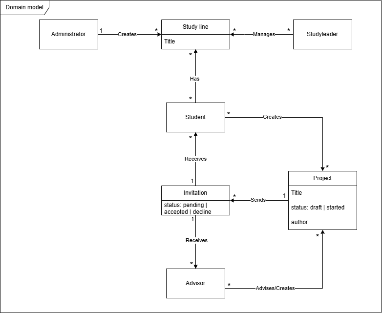
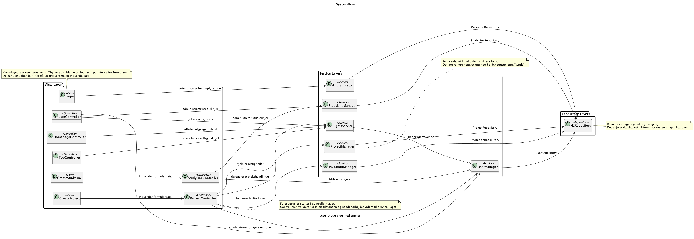
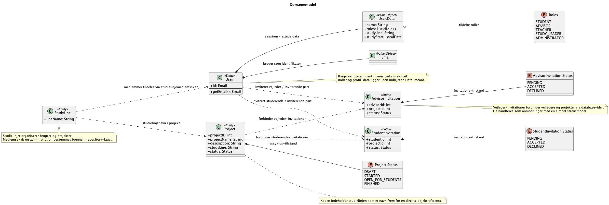
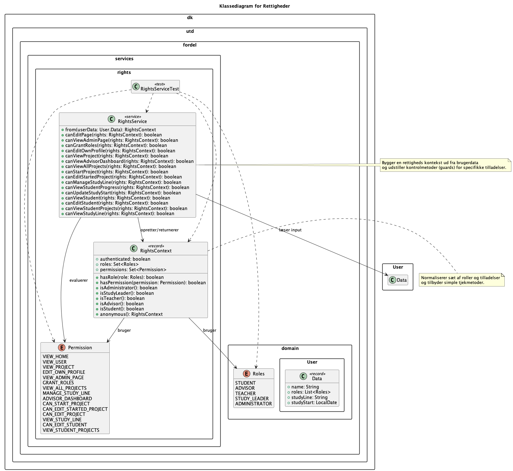
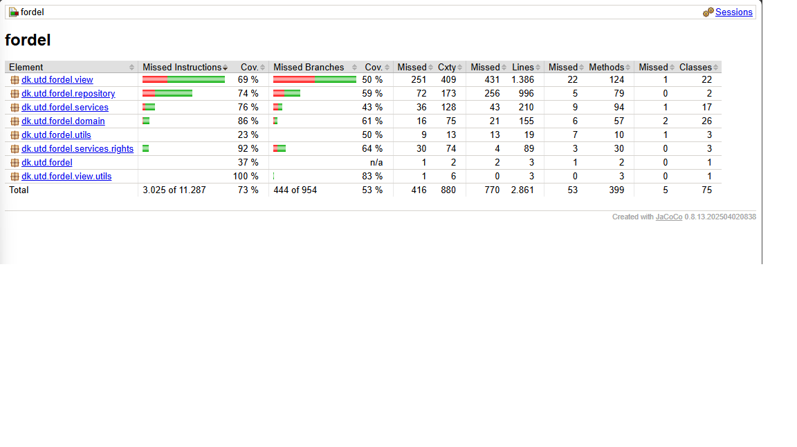

authors:
- name: Magnus Friis
  - studentid: s251019
- name: Lasse Pedersen
  - studentid: s255896
- name: Mahmoud Mustafa
  - studentid: s244632
- name: Casper Rasmussen
  - studentid: s255762


# Rapport - Fordel 14
### Indholdsfortegnelse
- [Report contribution](#Report-contribution)
- [Use of AI](#Use-of-AI)
- [Statement on code contribution score](#Statement-on-code-contribution-score)
- [Indledning](#Indledning)
- [Kravanalyse](#Kravanalyse)
- [Planlægning og design](#Planlægning-og-design)
- [Implementering](#Implementering)
- [Validering](#Validering)
- [Diskussion](#Diskussion)


## Report contribution

| Del af rapporten          | Casper (s255762) | Lasse (s255896) | Magnus (s251019) | Mahmoud (s244632) |
|---------------------------|------------------|-----------------|------------------|-------------------|
| **Indledning**            | 0%               | 100%            | 0%               | 0%                |
| **Kravanalyse**           | 100%             | 0%              | 0%               | ?%                |
| **Planlægning og design** | 0%               | 0%              | 100%             | 0%                |
| **Implementering**        | ?%               | 60%             | 20%              | 20%               |
| **Validering**            | ?%               | ?%              | ?%               | 100%              |
| **Diskussion**            | ?%               | 50%             | 50%              | ?%                |


## Use of AI
### s255896 (Lasse Pedersen)
> Som et personligt princip har jeg valgt aldrig at bruge AI eller coding-agents til direkte generering af min kode, såkaldt "vibe-coding".
> Min erfaring viser, at direkte genereret kode ofte fejler. AI-modeller kan hallucinere, og resultatet er sjældent maintainable eller i overensstemmelse med de principper for softwarearkitektur og clean code, vi lærer på universitetet (og som jeg opretholder for mig selv). Vigtigst af alt fjerner det læringsprocessen. Hvis man ukritisk lader en coding-agent løse opgaverne, fjerner man den faglige forståelse, da man kun for alvor lærer af fejl, man selv har begået og løst.
> I stedet bruger jeg AI som en sparringspartner (næsten som en TA). Jeg anvender det i planlægningsfasen til at tage overvejelser ift. arkitekture, samt som et ekstra sæt øjne til code reviews og fejlfinding. 
> Derudover bruger jeg AI værktøjer sprogligt til grammatisk kvalitetssikring, såsom at fange stavefejl og glemte kommaer i min egen tekst, uden at lade den formulere selve indholdet.
> Målet er aldrig at blive afhængig af AI, men at arbejde sammen med det og bruge det som et værktøj, der løfter det endelige produkts kvalitet og understøtter min egen faglige og personlige udvikling.

> Jeg blev dog nødt til at lave en undtagelse for dette princip en enkelt gang under projektet for at overholde deadlinen. Aftenen før det sidste kundemøde (vores endelige user story-deadline) opdagede vi alt for sent, at test-frameworket Mockito, som jeg havde brugt, fejlede på de andres computere. For at redde situationen og nå deadlinen var jeg tvunget til at lade en AI omskrive de 20-30 tests, jeg oprindeligt havde skrevet, der gjorde brug af Mockito, så de ikke længere var afhængige af Mockito. I denne situation fungerede AI’en udelukkende som en oversætter af mine egne, eksisterende tests, hvilket var afgørende for, at vi nåede i mål til tiden med en acceptabel test coverage.
> AI'en oprettede en java-klasse under test/testsupport, der hedder TestFakes.java, som lod tests'ne gøre brug af Mockito-funktioner (mock-objekter, osv.) uden at have Mockito som en dependency.

### s251019 (Magnus Friis)
> I vores gruppekontrakt har vi angivet at brugen af AI skal være begrænset til den samme funktion som en hjælpelærer. 
> Dette vil sige at vi ikke må bruge AI til at "producere" kode for os, men bruge det som et værktøj til at få svar på spørgsmål, 
> eller sætte sig ind i noget nyt konceptuelt udfordrende. Jeg har i løbet af projektet sørget for at begrænse mit eget 
> brug af AI i sådan en grad, at det overholder den kontrakt vi lavede som gruppe da vi gik ind til samarbejdet. Konkret har jeg brugt 
> AI til at søge ny viden, finde inspiration til at løse opgaver og til at hjælpe med at de "bugs" der er opstået under udvikling.
> Personligt er det vigtigste for mig, at jeg føler jeg får det samme indlæring om jeg bruger AI eller ej, og jeg vurderer at jeg har fået lige så meget, 
> hvis ikke mere, ud af projektet sammenlignet med tidligere projekter uden brug af AI.
> 
> Derudover har jeg brugt AI til at rette stavefejl i rapporten, og til at hjælpe med at kontrollere at meningen bag det jeg skriver, 
> også er det der opfattes af læseren - dog uden at skrive teksten for mig.  

### s244632 (Mahmoud)
> Jeg har anvendt AI-værktøjer til sproglig og grammatisk kvalitetssikring og til at finde stavefejl og manglende kommaer i min egne tekster. Da jeg er ordblind, laver jeg ofte stavefejl, og AI har derfor fungeret som et hjælpemiddel til korrekturlæsning. AI er ikke blivet brugt til at formulere eller udvikle indholdet. Derudover har jeg anvendt AI som et læringsværktøj til at søge viden og få forklaringer på spørgsmål som jeg havde svært ved at forstå. AI har kun været brugt som en hjælp til at forstå emnet bedre.  
## Statement on code contribution score
i §2 i vores gruppe kontrakt har vi noteret:
> "Vi vil gerne prøve at fordele arbejdsmængden nogenlunde lige, i sådan grad at alle er tilfredse med deres bidragelse."

Contribution-scoren afspejler, at arbejdsfordelingen i gruppen ikke har været helt ens. 
Gruppen havde dog fra projektets begyndelse en fælles forståelse af, at alle skulle bidrage i et omfang, 
de selv kunne være tilfredse med, og det er den samlede vurdering, 
at dette er blevet overholdt. På trods af forskelle i contribution-scorerne har alle medlemmer bidraget med det 
de kunne, og samarbejdet har været godt gennem hele projektforløbet.

Udover code contribution score, er der også mere strukturelle arbejdsopgaver, der ikke bliver afspejles i scoren
— herunder planlægning, koordinering og idé generering.


## Indledning

Denne rapport beskriver udviklingen af Fordel 14, et system til håndtering af projekter, studielinjer, brugere og rettigheder for universitetet UTD. Projektet blev udviklet med udgangspunkt i kundens user stories, og undervejs har vi arbejdet tæt med kravafstemning og prioritering for at sikre os, at løsningen hænger sammen med de vigtigste behov i domænet. Rapporten er skrevet til en læser, der ønsker at forstå både problemet, vores valgte løsning og de vigtigste tekniske valg i projektet, uden at kende hele kodebasen på forhånd.

I de følgende afsnit gennemgår vi først kravanalysen, hvor user stories og domænet bliver omsat til centrale begreber og relationer. Derefter beskriver vi planlægningen og designet, hvor vi forklarer, hvordan opgaven blev opdelt, og hvordan arkitekturen blev struktureret for bedst at understøtte samarbejde og videreudvikling. I implementerings-delen fokuserer vi på den konkrete kodebase, herunder lags opdelingen i systemet, de vigtigste domæneklasser og de patterns, vi har brugt til at holde løsningen overskuelig, læsbar og maintainable. Til sidst gennemgår vi validering og diskussion, hvor vi vurderer, hvad der fungerede godt, og hvad vi lærte af processen.

## Kravanalyse
> _Hvad er problemet?_

UTD har i længere tid oplevet at håndteringen af projekter og studielinjer, samt tildelingen af vejledere ofte en kompleks proces, 
der involverer mange forskellige typer af brugere, det alt fra den studerende til administratorer og studieledere. Uden et system
til håndtering af ovenstående kan overblikket over invitationer, projektstatus og godkendelser let gå tabt. Kunden har i denne forbindelse
præsenteret os for en en række krav i form af user stories. Kravene vil i dette afsnit blive præsenteret, analyseret og gennemgået, for at danne
overblik over problemet og den tilhørende applikation. Dette vil sikre at udvikling af produktet starter i den rigtige retning.

Tabellen viser en liste over alle user stories, som kunden har fremlagt.

| ID        | User Story                                                                                                                                                                          |
|:----------|:------------------------------------------------------------------------------------------------------------------------------------------------------------------------------------|
| **US-1**  | **Login:** **As** any user of the site **I want to** be able to authenticate myself **such that** I can get a personalized view and options                                         |
| **US-2**  | **Create A Study Line:** **As** the administrator **I want to** create study lines **such that** I can assign students and study leaders                                            | 
| **US-3**  | **Create Advisors:** **As** the administrator **I want to** assign users as advisors **such that** they can advise students                                                         | 
| **US-4**  | **Assign Study Leaders:** **As** the administrator **I want to** assign a study leader to a study line **such that** they can administrate the students of that line                | 
| **US-5**  | **Assign Students:** **As** a study leader **I want to** assign students to a study line **such that** I can monitor and help them complete their projects                          |
| **US-8**  | **Advisor Project Choice:** **As** an advisor **I want to** see a list of potential projects **such that** I can choose some to advise                                              |
| **US-9**  | **Advisor Project Dashboard:** **As** an advisor **I want to** see a list of projects I have accepted to advise **such that** I can have an overview of the projects I'm advising   |
| **US-10** | **Project Creation:** **As** a student **I want to** to create a project **such that** it can be chosen by an advisor                                                               |
| **US-11** | **Project Draft Creation:** **As** a student **I want to** save the project as a draft **such that** I do not have to publish an unfinished project                                 |
| **US-12** | **Multistudent Project:** **As** a student **I want to** to add other students to my project **such that** I can work with them on the project                                      |
| **US-13** | **Project Collaborator Invitation:** **As** a student **I want to** accept or reject an invitation to be part of a project **such that** I can choose which project to work on      |
| **US-14** | **Project Advisor Invitation:** **As** a student **I want to** see a list of potential advisors **such that** I can send a request to join the project                              |
| **US-16** | **Advisor Workload:** **As** an advisor **I want to** set my acceptable workload **such that** students do not contact me when I am full                                            |
| **US-19** | **Advisor Project Creation:** **As** an advisor **I want to** publish a potential project **such that** students can choose it                                                      |
| **US-20** | **Have a Cookie Notice:** **As** any user **I want to** to be informed about the use of cookies **such that** my rights are upheld                                                  |
| **US-21** | **Delete Users:** **As** any user **I want to** to be able to have my account deleted **such that** my rights are upheld                                                            |
| **US-22** | **Change name:** **As** any user **I want to** to be able change my name and information **such that** be represented as I prefer                                                   |
| **US-23** | **Add student progress:** **As** a student **I want to** to be able set my start date **such that** the system can calculate approximate start dates for internship and the project |
| **US-25** | **Invite co-advisors:** **As** an advisor **I want to** to be able to invite students and other advisors to the project **such that** I can get a co-advisors                       |
| **US-26** | **Update of project:** **As** an advisor **I want to** to be able update the name and abstract of the project after start **such that** the description match the project done      |
| **US-27** | **A Change of Language:** **As** a user **I want to** to be able to see the webpage in both Danish and English **such that** the page is easy to understand for me                  |
| **US-28** | **Expire Passwords:** **As** a system administrator **I want to** require passwords to expire after 3 months **such that** to harden the security of the system                     |

### User story analyse


---
For at danne et overblik over produktet og hvad de forskellige ord i user stories betyder, har vi valgt at lave en analyse af user stories 
med udgangspunkt i de mest centrale begreber. I analysen har vi kigget på hvilke navneord, tillægsord og udsagnsord der optræder i de forskellige
user stories. Det fortæller nemlig ofte hvilke entities, attributes og relations, produktet skal bestå af. Dette kan senere i udviklingsprocessen 
bruges at få et hurtigt overblik over hvad databasen skal bestå af, samt hvordan de forskellige roller og entities intetagerer med hinanden.

| Ord           | Ordklasse  | Domain model type |   | Ord          | Ordklasse  | Domain model type |         
|:--------------|:-----------|:------------------|:-:|:-------------|:-----------|:------------------|
| Administrator | Navneord   | User role         |   | Invitation   | Navneord   | Entity            |
| Advisor       | Navneord   | User role         |   | Advise       | Udsagnsord | Relation          |
| Student       | Navneord   | User role         |   | Invite       | Udsagnsord | Relation          |
| Study leader  | Navneord   | User role         |   | Join         | Udsagnsord | Atribute          |
| Project       | Navneord   | Entity            |   | Reject       | Udsagnsord | Atribute          |
| Study line    | Navneord   | Entity            |   | Send         | Udsagnsord | Relation          |
| Description   | Navneord   | Atribute          |   | Administrate | Udsagnsord | Relation          |

På baggrund af vores user story analyse har oversat ovenstående tabel til en domain model, som har til formål at visualiserer systemet arkitektur, og
samtidig skabe en sammenhængen mellem de forskellige attributes, entities og relations. Pilene forklarer med en kort forklarende tekst forholdet.
**"1"** og **"*"** fortæller os om kardinaliteten i forholdet, hvis vi for eksempel kigger forholdet mellem **administrator** og **study line** er
"one-to-many", hvilket fortæller os at _en administrator_ kan lave flere _study lines_, men at _en study line_ kun kan blive lavet af _en administrator_. 
Kigger vi i stedet på forholdet mellem **advisor** og **project**, som er "many-to-many", kan det beskrives som at _mange advisors_ kan oprette og vejlede
_mange projekter_, og at et/mange projekter godt kan have flere advisors. 



### System roller

---
Kigger man de forskellige user stories igennem, bliver det hurtigt klart, at kunden forventer et system, 
hvor brugerne kan tildeles forskellige roller med dertilhørende rettigheder. Det har derfor været essentielt 
at få skabt et overblik over, hvilke roller der findes i applikationen, og hvad de hver især har tilladelse til.
På baggrund af de givet user stories har vi derfor lavet et overblik over de forskellige roller og hvilket rettigheder
vi forventer de skal, så vi senere i udviklingen hurtigt kan få et overblik og rollerne. 

**Any user**
- Login
- Ændre navn
- Ændre sprog
- Slette egen bruger

**Administrator** 
- Oprette studielinjer 
- Tildele roller


**Study leader**
- Tilføje students til sin linje
- Råde over deres tildelte linje
- Kontakte students

**Advisor**
- Vejlede studerende
- Se en oversigt over projekter som de kan vejlede
- Se en oversigt over projekter de vejleder
- Sætte et workload så de ikke får mange projekter de ikke har tid til
- Oprette advisor projekter
- Opdaterer projekt navne eller beskrivelser

**Student**
- Oprette projekter
- Sætte en status på projektet
- Tilføje/invitere andre students til et projekt
- Accepterer eller afslå invitation til andre projekter
- Tilføje/invitere advisors til et projekt
- Tilslutte sig advisor projekter
- Sætte en studie start dato

### Prioritering af user stories (MoSCoW model) 

---
Vi har valgt at lave en MoSCoW til nemt at få et overblik over hvordan vi skulle prioriterer de forskellige user stories.
Da vi arbejder med en kunde er det meget vigtigt at få forventningsafstemt deres forventninger med vores. For så vidt
muligt at imødekomme kunden krav og behov. Vi kommer mere ind på, [senere i afsnittet](#Forventningsafstemning-af-krav-med-kunden),
hvordan de forskellige modeller i dette afsnit har ændret sig i forbindelse med de snakke vi har haft med kunden
undervejs.
### Must Have
*Kritiske user stories, der SKAL være med i vores Minimum Viable Product (MVP). Uden disse fungerer systemet ikke.*

| ID        | User Story                                                                                                                                                                     |
|:----------|:-------------------------------------------------------------------------------------------------------------------------------------------------------------------------------|
| **US-1**  | **Login:** **As** any user of the site **I want to** be able to authenticate myself **such that** I can get a personalized view and options                                    |
| **US-2**  | **Create A Study Line:** **As** the administrator **I want to** create study lines **such that** I can assign students and study leaders                                       |
| **US-3**  | **Create Advisors:** **As** the administrator **I want to** assign users as advisors **such that** they can advise students                                                    |
| **US-4**  | **Assign Study Leaders:** **As** the administrator **I want to** assign a study leader to a study line **such that** they can administrate the students of that line           |
| **US-5**  | **Assign Students:** **As** a study leader **I want to** assign students to a study line **such that** I can monitor and help them complete their projects                     |
| **US-8**  | **Advisor Project Choice:** **As** an advisor **I want to** see a list of potential projects **such that** I can choose some to advise                                         |
| **US-10** | **Project Creation:** **As** a student **I want to** to create a project **such that** it can be chosen by an advisor                                                          |
| **US-12** | **Multistudent Project:** **As** a student **I want to** to add other students to my project **such that** I can work with them on the project                                 |
| **US-13** | **Project Collaborator Invitation:** **As** a student **I want to** accept or reject an invitation to be part of a project **such that** I can choose which project to work on |
| **US-14** | **Project Advisor Invitation:** **As** a student **I want to** see a list of potential advisors **such that** I can send a request to join the project                         |

---

### Should Have
*Vigtige funktioner, der skaber stor værdi for brugeren, men som kan udskydes, hvis tiden bliver for knap.*

| ID        | User Story                                                                                                                                                                          |
|:----------|:------------------------------------------------------------------------------------------------------------------------------------------------------------------------------------|
| **US-9**  | **Advisor Project Dashboard:** **As** an advisor **I want to** see a list of projects I have accepted to advise **such that** I can have an overview of the projects I'm advising   |
| **US-11** | **Project Draft Creation:** **As** a student **I want to** save the project as a draft **such that** I do not have to publish an unfinished project                                 |
| **US-16** | **Advisor Workload:** **As** an advisor **I want to** set my acceptable workload **such that** students do not contact me when I am full                                            |
| **US-19** | **Advisor Project Creation:** **As** an advisor **I want to** publish a potential project **such that** students can choose it                                                      |
| **US-23** | **Add student progress:** **As** a student **I want to** to be able set my start date **such that** the system can calculate approximate start dates for internship and the project |
| **US-25** | **Invite co-advisors:** **As** an advisor **I want to** to be able to invite students and other advisors to the project **such that** I can get a co-advisors                       |
| **US-28** | **Expire Passwords:** **As** a system administrator **I want to** require passwords to expire after 3 months **such that** to harden the security of the system                     |

---

### Could Have
*Nice-to-have features. Disse kigger vi kun på, hvis vi er foran tidsplanen.*

| ID        | User Story                                                                                                                                                                     |
|:----------|:-------------------------------------------------------------------------------------------------------------------------------------------------------------------------------|
| **US-20** | **Have a Cookie Notice:** **As** any user **I want to** to be informed about the use of cookies **such that** my rights are upheld                                             |
| **US-21** | **Delete Users:** **As** any user **I want to** to be able to have my account deleted **such that** my rights are upheld                                                       |
| **US-22** | **Change name:** **As** any user **I want to** to be able change my name and information **such that** be represented as I prefer                                              |
| **US-26** | **Update of project:** **As** an advisor **I want to** to be able update the name and abstract of the project after start **such that** the description match the project done |

---

### Won't Have
*Funktioner vi aktivt har valgt fra i denne omgang for at holde fokus.*

| ID        | User Story                                                                                                                                                         |
|:----------|:-------------------------------------------------------------------------------------------------------------------------------------------------------------------|
| **US-27** | **A Change of Language:** **As** a user **I want to** to be able to see the webpage in both Danish and English **such that** the page is easy to understand for me |
 

### Forventningsafstemning af krav med kunden

---
I dette projekt er kravene til produktet blevet præsenteret i user stories. Selvom user stories fortæller meget om 
hvad kunden forventer er det stadig ikke fuldstændig tydeligt, derfor er det vigtigt at have en aktiv dialog med 
kunden undervejs i udviklingen af produktet for at tydelig gøre kravene kunden har. Vi har undervejs været til to 
møder med kunden, hvor vi haft mulighed for at få et bedre indblik i hvad kunden forventer applikationen skal kunne. 
Dette har gjort det nemmere at lave MoSCowW-prioritering af de forskellige user stories, da det gennem dialogen blev 
tydeligt, hvilke user stories der reelt skabte den største værdi. Allerede under det første møde blev det for eksempel 
tydeligt, at kundens behov for at en bruger skulle kunne oprette projekter (US-10). Dette var ikke krav vi havde vurderet
til at være must have, men samtalen gjorde at det blev prioriteret. Samtidig blev vi også klogere på domainet. Gennem
dialogen med kunden blev det meget tydeligt hvilke relationer der var i mellem brugere, projekter, study lines osv... 


## Planlægning og design
I dette afsnit vil vi gennemgå gruppens planlægning igennem projektets forløb, og i sammenhæng kigge på de designmæssige
tiltag der er blevet taget for at sikre at gruppen kunne efterleve denne planlægning. I vores diskussion vil vi vende tilbage til
planlægningen, hvor der reflekteres over hvad vi som 
gruppe vil gøre anderledes i fremtidige projekter. 

### Tilgang til User Stories 
Ved projektets start blev der sat tid af til, at hvert gruppemedlem kunne sætte sig ned og danne sig et overblik over projektet, 
dets user stories og den tilhørende kodebase. Dette blev gjort for at udarbejde en handleplan, 
der afspejlede den eksisterende kodebase, samt for at finde ud af, 
hvordan vi i praksis kunne implementere de givne user stories. Inden vores første møde ("M1") med kunden blev der derfor kun implementeret en meget begrænset mængde kode.

Igennem projektet blev det klart for os at vi kunne implementere forskellige User stories på samme tid, uden implementationerne overlappede hinanden.
Altså kunne vi dele det overordnede system op i del-opgaver der i starten kunne implementeres selvstændigt og virke som sit eget system. På den måde kunne vi 
imellem M1 og M2 arbejde sideløbende på flere forskellige systemer, der var med til at løse hver deres User stories.  

Det handlede derfor for os, som en start, at udvælge nogle 
user stories hvor de tilhørende implementationer kunne fungere uafhængigt af hinanden. Et eksempel på dette kunne være US10 (Project Creation) & US2 (Create A Study Line), 
der i første omgang godt kunne implementeres uden funktionelt overlap. Når begge user stories blev implementeret selvstændigt, 
kunne der herefter arbejdes på at skabe sammenhængende funktioner, som at give et projekt in tilhørende studielinje, eller på at vise alle projekter der tilhører en studielinje.

### Planlægning

For at have den ovenstående tilgang til vores user stories, krævede det at vi som gruppe kunne uddelegere de forskellige del-opgaver. 
Derfor aftalte vi i vores gruppe kontrakt, at der som udgangspunkt skulle mødes 2-3 gange om ugen. Dette bidragede til at skabe overblik over vores fremskridt 
med user stories, og uddelegere user stories og del opgaver der afhænger af nogle af de delsystemer der allerede er blevet eller ville blive
implementeret. 

For at give et indtryk af vores fremgangsmåde har vi, efter vores sidste møde ("F1"), lavet nedenstående Gantt-diagram for at vise 
hvordan vi har grebet de forskellige user stories an. Gantt diagrammet viser blandt andet hvilke arbejdsopgaver der kunne løses uden nogle foregående
funktionaliteter, og hvilke user stories der direkte afhænger af løsningen på andre del-opgaver. For at gøre diagrammet mere overskueligt 
fungere de forskellige møder med kunden som en "nulstilling" for at gøre diagrammet mere overskueligt.


Som det fremgår i Gantt diagrammet har vi arbejdet ud fra nogle møder med vores kunde, der har fungeret som deadlines af udvalgte user stories.
I den anledning kunne møderne også bruges til at undersøge hvad der lægges mest vægt på fra kundens side, og hvad der skal tilrettes
af det der allerede var blevet udviklet.

Inden vores andet møde med kunden ("M2"), aftalte vi at have produceret et "minimal viable product" (MVP), baseret på de tilgængelige user stories, 
og de indtryk vi havde fået fra kundens prioriteringer. Dette viste sig at fungere som en god milepæl for vores projekt, da de udvalgte user stories lagde et godt fundament
for de user stories vi blev præsenteret for efter mødet. 

Op til mødet var vi også tvunget til at tage stilling til hvilke user stories vi i første omgang ikke havde tid
til at færdiggøre, hvilket også blev gjort ud fra de indtryk vi havde fået fra kunden. Vi valgte blandt andet at fokusere mest på at etablere 
noget funktionelt i forhold til at få oprettet projekter, og etablere en kommunikation, hvilket var et af de punkter kunden lagde vægt på. 
Her valgte vi også at fravælge udvalgte user stories som US23 (add student progress), hvilket vi også har defineret som et "should have" i 
stedet for et must have i vores MoSCoW analyse.

Efter vores andet møde ("M2") og frem mod den endelige præsentation af vores produkt ("F1"), kunne vi fokusere på at få udviklet nogle af de user stories vi ikke nåede 
at færdiggøre frem til mødet, samt de nye user stories der allerede byggede på noget af den funktionalitet vi havde implementeret. Gruppen planlagde at der, de sidste 2 dage op til mødet 
ikke skulle udvikles nye funktionaliteter, men fokuseres på JUnit test, samt at raffinere vores produkt og gøre det klar til at blive præsenteret for kunden. 

Dette resulterede i at vi nåede alle user stories undtagen US27 (A change of language), som vi også har fravalgt os i vores MoSCoW analyse, for at holde fokus på de 
egentlige funktionaliteter. Det bør også noteres at et andet sprog ville kunne tilføjes uden at skulle modificere noget af den i forvejen implementerede logik. 


#### Ændringer efter M1
Inden det første møde med kunden havde vi lagt en plan for den handlingsplan vi gerne ville præsentere kunden. Dette viste sig
at være overflødigt, da kunden havde nogle andre forventninger end dem vi indledningsvis forventede. Derfor måtte vi
omlægge vores plan til at bedre kunne imødekomme kunden forventninger. Til vores fordel havde vi valgt ikke at begynde 
at producere noget kode før M1.

#### Ændringer efter M2
Under mødet med kunden blev vores tolkning af rolle systemet udfordret. Det resulterede i at vi var nødt til at sætte tid af til at omskrive 
vores rolle system, og tilhørende systemer. Vi valgte her at fortsætte med at implementere nye funktionaliteter mens rollesystemet blev omskrevet. 
Konsekvenserne af dette vil vi reflektere yderligere over i vores diskussion. Implikationerne af dette vil der vendes tilbage til i diskussionen.  

### Arkitektur

> En "layered" arkitektur er et designmønster hvor systemet opdeles i lag, der hver har et veldefineret ansvar. Hvert lag må kun kommunikere med det lag direkte under eller over sig, hvilket reducere afhængigheder på tværs af systemet [4] 

Systemet er opbygget efter en "layered" arkitektur, hvor de forskellige lag har forskellige funktionaliteter og formål.
Denne opdeling praktiserer "separation of concerns", hvilket gør systemet mere skalerbar, testbar og nemmere at vedligeholde **[1]**. 


Den overordnede filstruktur i projektet afspejler den her "layered" arkitektur, og er organiseret i følgende hovedområder: 
- **domain** indeholder domænemodeller og entiteter, der repræsenterer systemets og dets forretningsobjekter. Klasserne i domain afspejler den data der arbejdes med i systemet på tværs af lagene.  
- **repository** står alene for at kommunikere med databasen. Her implementeres der SQL-operationer, der anvendes til oprettelse, sletning og hentning af data. 
Ved at samle database adgangen i ét lag, fremmer vi også **"high cohesion"**, da laget har et meget veldefineret ansvar.  
- **services** indeholder projektets forretningslogik, og klasser som "ProjectManager" fungerer som et bindeled mellem view-laget og repository-laget. Service-laget koordinerer kald til 
repository laget, håndterer domæne logik og gør det muligt at genbruge kode på tværs af systemet. Dette er med til at fremme **"low coupling"** da service-laget abstraherer repository-laget
væk fra view laget, så de enkelte lag kan ændres uafhængigt af hinanden.
- **view** håndterer præsentationen af data fra repository laget over for brugeren, og gør brug af Thymeleaf og Spring boot til at vise og hente data. 
- **resources** indeholder database migrations, HTML-skabeloner og statiske filer som CSS og JavaScript.

Ved at bruge denne arkitektur, har vi en klar opdeling af ansvar, hvor ændringer i ét lag, har minimal påvirkning på de øvrige lag. Det har givet os fleksibilitet i udviklingen
og gjort det nemmere for os at arbejde parallelt på de forskellige dele af systemet. I vores diskussion vil vi komme ind på hvordan 
man kunne have styrket **separation of concerns** ved at lave en endnu bedre arkitektur. 

### Delsystemer

Som beskrevet i planlægning og arkitektur, ligges der i projektet vægt på at opsætte delsystemerne, 
så vi i gruppen kan arbejde parallelt med hinanden.  

De delsystemer vi vil implementere er følgende: 
- **User creation** er allerede implementeret ved starten af projektet. 
- **User management** er også implementeret, men skal modificeres til at passe til vores user stories.
- **Roles** skal sættes op, så der er klar forskel på de forskellige roller en user kan have i systemet. Herunder skal der være et system til at opsætte roler til forskellige brugere. 
- **Project creation** skal stå for at oprette projekter
- **project management** skal kunne modificere projekter, og gøre at projektet kan ejes af en user. 
- **invitations** skal til at starte med kunne stå for at invitere advisor roller til projekter. 
- **Study line creation** håndtere oprettelse af nye studie linjer.  
- **Study line management** skal kunne modificere studielinjer, samt hvem der hører til hvilke studielinjer, 
og hvilke projekter der tilhører hvilke studielinjer. 

For at give et billede på hvordan vi vil implementere de forskellige delsystemer, kan vi vise hvordan oprettelsen af et projekt foregår:


Diagrammet viser hvordan en bruger interagerer med systemet for at oprette et projekt. Controlleren modtager requestet,
videresender det til service-laget, som koordinerer kald til repository-laget for at gemme projektet i databasen. I diagrammet viser vi også hvordan 
vi giver brugeren respons - dette uddybes yderligere i implementering. 

## Implementering


#### Implementerede user stories og tidsforløb

Som beskrevet tidligere under Planlægning, bliv implementering delt op efter de forskellige kundemøde. Før M1 brugte vi mest tid på at forstå den eksisterende kodebase, de forskellige user stories og hvad kunden forventede af systemet. Derfor blev der kun implementeret meget lidt kode før M1.

Mellem M1 og M2 arbejdede vi på at få et MVP på plads. Her fokuserede vi først på de dele af systemet, som de andre funktioner byggede videre på. Det var blandt anden login, brugerhåndtering, roller, study lines og project creation. Disse dele gjorde det muligt at arbejde videre med de mere sammenhængende flows i systemet.

Efter M2 arbejdede vi videre med de user stories, som enten ikke var færdige endnu, eller som byggede oven på den funktionalitet vi allerede havde lavet. Her arbejdede vi blandt andet med projekter, invitationer, advisor-funktioner, student progress, password expiry og rettigheder. Vi måtte også ændre i rollesystemet, da vores første forståelse af rollerne ikke passede helt med kundens forventninger.

Frem mod F1 blev fokus flyttet fra nye funktioner til at samle systemet, rette fejl og gøre det klar til præsentation. De sidste dage blev især brugt på JUnit tests og på at forbedre de vigtigste flows.

#### Værktøjer og biblioteker 

Projektet er lavet som en Java webapplikation med Spring Boot. Maven bruges til at bygge og køre projektet. Thymeleaf bruges til HTML-siderne, og H2 bruges som database i projektet, blandt andet under udvikling og test.

Det vigtigste værktøjer og biblioteker er Java 21, Spring Boot 3.4.4, Maven, Thymeleaf, H2, htmx-spring-boot-thymeleaf 4.0.1, spring-security-crypto 6.4.5, BouncyCastle 1.76, JUnit og JaCoCo 0.8.13.

#### Sådan køres projektet 

Projektet kan køres lokalt med Maven. Først åbnes projektmappen i en terminal, og derefter kan applikationen startes med:

```bash
mvn spring-boot:run
```

Når applikationen kører, kan man åbne den i browseren på:

```text
http://localhost:8080
```
Testene kan køres med:

```bash
mvn verify
```
Efter testkørslen kan code coverage ses i:

```text
target/site/jacoco/index.html
```


#### Database og database design


#### Arkitektur og Systemstruktur

Dette afsnit er til formål at give et overblik over kodebasen og de vigtigste valg, der blev taget i systemets implementering. Formålet er ikke at gennemgå hver enkelte klasse i detaljer, men at forklare hvordan koden er organiseret, og hvordan de vigtigste dele af løsningen hænger sammen. På denne måde kan det forstås, hvordan projektet er bygget op, inden de more specifikke patterns og klasser bliver gennemgået.

I det følgende beskrives der derfor de vigtigste lag i systemet, deres ansvar og hvordan de hænger sammen i den samlede arkitektur.

Systemet er opbygget efter et "layered architecture", hvor hvert lag har sit eget ansvar.

##### Domain

`domain` indeholder systemets domain-models og entities. Her ligger de klasser, der repræsenterer de centrale entities i problemet, for eksempel brugere, projekter, studielinjer og invitationer. Laget bruges til at modellere data og forretningsobjekter uden at blande præsentation eller databaseadgang ind i them.

```Java
public enum Roles {
    STUDENT(1),
    ADVISOR(2),
    TEACHER(3),
    STUDY_LEADER(4),
    ADMINISTRATOR(5);

    private final int clearanceLevel;

    Roles(int clearanceLevel) {
        this.clearanceLevel = clearanceLevel;
    }

    public int getClearanceLevel() {return clearanceLevel;}
}

```

Eksemplet ovenfor viser `Roles`-enumen, som er en del af domain-laget. Den indkapsler de forskellige typer af brugere i systemet og knytter et `clearanceLevel` til hver rolle, hvilket viser en business-rule som ikke er afhængig af databaser eller web-routing.

##### Repository

`repository` har ansvaret for at kommunikere med databasen. Her findes de metoder, der læser, opretter, opdaterer og sletter data i databasen. Dette lag bruges til at isolere SQL og dataadgang fra resten af systemet, så resten af koden ikke behøver at kende databasens opbygning.

```Java
private int getRoleIdByName(Roles role) throws SQLException {
        var stmt = "SELECT id FROM roles WHERE name = ?";
        try (var statement = getConnection().prepareStatement(stmt)) {
            statement.setString(1, role.name().toLowerCase().replace("_", " "));
            try (var resultSet = statement.executeQuery()) {
                if (resultSet.next()) {
                    return resultSet.getInt("id");
                }
            }
        }

        throw new SQLException("Role does not exist: " + role);
    }

```

Dette eksempel illustrerer en intern hjælpemetode i repository-laget, der udfører en direkte SQL-request mod databasen for at slå et specifikt ID op baseret på en domænerolle. Ved at placere denne SQL-logik på dette lag, sikres det, at databasens struktur holdes skjult for resten af applikationen, da dette ansvar kun placeres på klassen der er ansvarlig for at kommunikere med databasen.

##### Services

`services` indeholder business-logic. Her samles den kode, der har ansvar for handlinger på tværs af flere dele af systemet, fx. når en bruger skal oprette et projekt eller se deres rettigheder. Laget bruges til at binde controller og repository sammen, så logikken ikke ender spredt ud flere steder.

```Java
public static interface ProjectRepository {
    void create(Project project, User user, int userId) throws ProjectTitleAlreadyInUse;

    void create(Project project, User user, String studyLineName, int userId) throws ProjectTitleAlreadyInUse;


    List<Project> getAllProjectsRelatedToUser(User user) throws Project.InvalidProject;

    List<Project> getAllProjectsRelatedToStudyLine(int studyLineId);

    List<Project> getAllProjectsRelatedToStudyLineAndUser(int studyLineId, User user);

    boolean canViewProject(User user, int projectId);

    String getProjectCreatorEmail(int projectId);

    void kickMemberFromProject(int projectId, User member);

    List<Project> getAllAdvisorProjects(User advisor);

    int getCountOfAdvisorProjects(User advisor);

    void startProject(int pId) throws ProjectAlreadyFinished;

    void update(Project project) throws ProjectDoesNotExist;

    void advisorCreation(Project project, String studyLineName, int userId);

    void delete(Project project) throws ProjectDoesNotExist;
    List<Project> getAllProjects() throws Project.InvalidProject;
    void assignAdvisor(User advisor,Project project) throws AdvisorAlreadyAdvises;
}

```

Eksemplet ovenfor viser et interface for et `ProjectRepository`, som defineres i service-laget. Dette gør det muligt for business-logic'en i servicelaget at diktere, hvilke operationer der skal være tilgængelige for projekthåndtering, uden at servicelaget behøver at bruge en specifik implementering af databasen.

##### View

`view` står for præsentationen af data til brugeren. Her ligger de templates, der viser siderne i browseren. Dette lag bruges til at håndtere brugerens interaktion med systemet.

```html
<!doctype html>
<html xmlns:th="http://www.thymeleaf.org" lang="da">

<head th:replace="~{fragments/head ::head}"></head>

<body>
    <header th:replace="~{fragments/header ::header}"></header>

    <main class="container">
        <section>
            <h1 th:text="${title}"></h1>

            <p>
                ...
            </p>

            <br>

            <div style="text-align: center;">
                
            </div>

        </section>
    </main>

    <footer th:replace="~{fragments/footer ::footer}"></footer>
</body>

</html>

```

Dette er en del af en Thymeleaf-skabelon som ligger i view-laget. Koden viser, hvordan præsentationen struktureres med HTML, mens dynamiske data (som f.eks. overskriften via `${title}`) indsættes på siden uden viden til, eller ansvar for, hvordan denne data blev fundet eller valideret.

##### Resources

`resources` indeholder de filer, som systemet bruger under kørsel, men som ikke selv er Java-kode. Dette er blandt andet database migrations, HTML-templates og statiske filer som CSS og JavaScript. Laget bruges til at samle de tekniske ressourcer, der understøtter applikationens funktion og udseende.

```JavaScript
document.addEventListener("DOMContentLoaded", () => {
    const searchInput = document.getElementById("search");
    const cards = Array.from(document.querySelectorAll("[data-user-name]"));
    const noResults = document.getElementById("users-no-results");

    if (!searchInput || cards.length === 0) {
        return;
    }

    let debounceTimer = null;

    const applySearch = () => {
        const query = searchInput.value.trim().toLowerCase();
        let visibleCount = 0;

        const nameMatches = cards.filter((card) => {
            const name = (card.dataset.userName || "").toLowerCase();
            return query === "" || name.includes(query);
        });

        const useEmailFallback = query !== "" && nameMatches.length === 0;

        cards.forEach((card) => {
            const name = (card.dataset.userName || "").toLowerCase();
            const email = (card.dataset.userEmail || "").toLowerCase();
            const matches = useEmailFallback
                ? email.includes(query)
                : query === "" || name.includes(query);
            card.hidden = !matches;

            if (matches) {
                visibleCount += 1;
            }
        });

        if (noResults) {
            noResults.hidden = visibleCount !== 0;
        }
    };

    searchInput.addEventListener("input", () => {
        window.clearTimeout(debounceTimer);
        debounceTimer = window.setTimeout(applySearch, 250);
    });

    applySearch();
});

```

Eksemplet ovenfor er et JavaScript script, der ligger i resource-laget. Det håndterer clientside-funktionalitet i form af en search funktion med debounce, der søger igennem brugere af systemet. Dette forbedrer brugeroplevelsen direkte i browseren uden at belaste serveren med en masse forespørgsler under søgning.

Udover static scripts og style.css indeholder resource-laget også vigtige komponenter til applikationens database og visuelle opbygning. Dette inkluderer Thymeleaf HTML-templates, som definerer brugergrænsefladen, samt SQL-migrationfiler (fra `0000.sql` til `0010.sql`). Disse migrationfiler sikrer, at databasens tabeller og startdata opbygges ensartet og automatisk, uanset om systemet kører i et lokalt udviklingsmiljø, under etsts, eller i produktion.

Et eksempel på dette er filen `0002.sql`, som opretter tabellerne til systemets rollestyring og udfulder databasen med de nødvendige standardroller:

```SQL
CREATE TABLE roles (
    id SERIAL PRIMARY KEY,
    name VARCHAR(50) NOT NULL UNIQUE
);

CREATE TABLE user_roles (
    user_id INT NOT NULL,
    role_id INT NOT NULL,

    PRIMARY KEY (user_id, role_id),

    FOREIGN KEY (user_id) REFERENCES users(id) ON DELETE CASCADE,
    FOREIGN KEY (role_id) REFERENCES roles(id) ON DELETE CASCADE
);

INSERT INTO roles (name) VALUES
    ('administrator'),
    ('advisor'),
    ('study leader'),
    ('teacher'),
    ('student');

```
##### Dataflow igennem systemet

En vigtigt del i systemets arkitektur er, hvordan data bevæger sig gennem de forskellige lag. Når en bruger interagerer med systemet i view-laget, bliver handlingen sendt videre til en controller, som modtager forespørgslen og beslutter, hvilket flow der skal følges. Controlleren fungerer som en mellemmand imellem viewet og den underliggende logik. Hvis handlingen fx. kræver business-logic, sendes den videre til service-laget, som udfører den nødvendige behandling. Når data skal gemmes eller hentes, kommunikerer service-laget videre med repository-laget, som står for forbindelsen til databasen. På denne måde sikres det ift. arkitekturen, at hvert lag kun har ansvar for sin egen del, og gør flowet mere overskueligt og lettere at vedligeholde.

> Flow for når en bruger opretter et nyt projekt på platformen:
> 1. **View:** Brugeren udfylder formularen i Thymeleaf-templaten `create-project.html`.
> 2. **Controller:** Data sendes til `ProjectController.java`, som modtager og validerer HTTP-forespørgslen.
> 3. **Service:** Controlleren kalder business-logic i `ProjectManager.java` (placeret i /services), som håndterer valideringsregler, såsom kontrol af dublerede titler.
> 4. **Repository:** `ProjectManager` kalder metoder på databaselaget, som eksekveres gennem den konkrete `H2Repository.java`, der foretager de direkte SQL-requests i H2-databasen.

##### Domæneklasser

Systemets domain-lag består af de klasser, der modellerer problemområdet, og som resten af applikationen bruger og bygger videre på. I dette lag ligger blandt andet brugere, projekter, studielinjer og invitationer, som tilsammen udgør de vigtigste entities i løsningen (domainet). Disse klasser repræsenterer systemets business objekter og bruges på tværs af resten af applikationen, ligegyldigt om data vises i view-laget, behandles i services eller gemmes i databasen. Domain-klasserne er med til at holde logikken samlet og gør det muligt at arbejde med en delt model af systemet igennem hele kodebasen.

> Kigger man direkte i projektmappen `src/main/java/dk/utd/fordel/domain`, ses det, hvordan problemområdets entities er opdelt i forskellige dedikerede Java-klasser. Objekterne relateret til business-logic repræsenteres af filer som `User.java`, `Project.java` og `StudyLine.java`.
> Logikken for "forretningsreglerne" holdes tæt på objekterne ved, at potentielle fejl er modelleret direkte som selvstændige klasser som fx. `ProjectTitleAlreadyInUse.java`, `AdvisorReachedMaxWorkLoad.java` og `StudentAlreadyInvited.java`. Resten af systemets arkitektur (services og controllere) genbruger disse fejl, hvilket sikrer, at "forretningsreglerne" aldrig dikteres af andre lag.

##### Dataflow i systemet

Det nedenstående diagram viser systemets overordnede kontrolflow og interaktion mellem komponenter henover systemets tre primære lag: view laget, service laget og repository leget.



Diagrammet viser en klar implementering af separation of concerns og loose coupling. Når en bruger interagerer med systemet (fx. via `Login` eller `CreateProject`), isoleres denne HTTP-forespørgsel med det samme i præsentationslaget, hvor controllere som `ProjectController` validerer input og session tilstanden.

Istedet for at lade controllere udføre databasetransaktioner eller forretningsregler direkte, deles ansvaret ud til dedikerede services som `ProjectManager` og `Authenticator`. Disse controllere sikrer, at præsentationslaget er uafhængigt af, hvordan forretningslogikken er implementeret. Endeligt er alt der har med SQL at gøre indkapslet i repository-laget `H2Repository`. Dette sikrer, at en ændring af databasen i fremtiden kan ske, uden at det bryder applikationens forretningslogik eller brugergrænseflade.

##### Domænemodellen

Det følgene diagram viser systemets domænemodel og illustrere entities og deres relationer.



Modellen er opdelt efter principperne fra Domain-Driven Design (DDD) ved at skelne mellem entities (`User`, `Project`, `StudyLine`) og Value Objects (`User.Data`, `Email`). For eksempel er brugerens data indkapslet i et final objekt (`User.Data`). Dette betyder, at dataen ikke kan ændres ved en fejl, hvilket beskytter systemet mod uforventede fejl og sikrer, at `User.Data` altid kan stoles på.

Et vigtigt valg ift. arkitektur i domænemodellen er loose coupling mellem forskellige entities. For eksempel refererer `Project` og `StudyLine` ikke til hinanden via direkte, referencer, men i stedet via simple datatyper som navne og database-id'er (f.eks. i `AdvisorInvitation`). Denne struktur minimerer afhængigheder der er unødvendige imellem domæneobjekterne og sikrer, at domænelaget forbliver light-weight og testbart.

Denne opdeling sikrer også, at systemets forskellige komponenter kan udvikles, testes og vedligeholdes relativt uafhængigt af hinanden.

##### Roller og rettigheder

Nedenstående klassediagram illustrerer systemets arkitektur for rettigheder. Diagrammet viser, hvordan adgangskontrol og rettighedsvalidering er struktureret for at bestemme, hvilke handlinger og endpoints en bruger har tilladelse til at bruge.



Modellen er opbygget omkring en klar separation af domæneroller `Roles` og konkrete, tilladelser `Permission`. I stedet for at hænge systemets business-logic direkte sammen med de overordnede roller, transformeres en brugers `User.Data` om til en rettighedskontekst, `RightsContext` af `RightsService`.

`RightsContext` fungerer som en normaliseret komponent, der indkapsler logikken for at checke rettigheder. Ved at dele evalueringen af specifikke handlinger ud (fx. `CAN_START_PROJECT` eller `MANAGE_STUDY_LINE`) til `RightsContext`, opnår systemet loose coupling. Hvis reglerne for fx. en `ADMIN` rolle eller en specifik tilladelse ændres i fremtiden, skal denne ændring kun laves i denne del af systemet, mens controllere og views forbliver uændret.

---

#### Software Patterns

Denne del af rapporten er dedikeret til at vise forskellige relavante principper og patterns brugt i koden.

##### GRASP: Pure Fabrication
> Pure Fabrication er når en klasse der ikke eksistere i problem-domænet bliver oprettet for at opnå low coupling og high cohesion. Denne klasse er ikke nødvendigvis en reflektion af et koncept fra den virkelige verden, men den bliver introduceret af tekniske årsager. **[2][3]**

Klassen `GlobalModelAdvice` centralisere data som alle views kan bruge ved automatisk at ligge `userData` og brugeres rights ind i modellen for alle requests. Dette er både klassens eneste mål, men også klassens eneste adfærd, hvilket giver klassen high cohesion.
Den henter `userData` fra http sessionen og hvis denne data findes returnere den både brugeres data og et `RightsContext` beregnet igennem `RightsService`. Hvis der ikke findes en bruger i sessionen gives der en "anonym" rettighedskontekst. På den måde slippes der fra at den samme logik gentages i hver controller (DRY).

Low Coupling opnås af `GlobalModelAdvice` da resten af systemet ikke behøver at kende detaljer om hvordan `userData` hentes fra sessionen, eller hvordan rettigheder beregnes. Controllers og views kan bare bruge de færdige attributter `userData` og `rights`. Dette betyder også at ændringer i session håndteren eller beregning af rettigheder kun kræver ændringer et sted.

Nedenfor kan implementeringen af denne klasse ses:

``` Java
@ControllerAdvice
public class GlobalModelAdvice {

    private final RightsService rightsService;

    public GlobalModelAdvice(RightsService rightsService) {
        this.rightsService = rightsService;
    }

    @ModelAttribute("userData")
    public User.Data userData(HttpSession session) {
        Object userData = session.getAttribute("userData");
        if (userData instanceof User.Data data) {
            return data;
        }

        return null;
    }

    @ModelAttribute("rights")
    public RightsContext rights(HttpSession session) {
        Object userData = session.getAttribute("userData");
        if (userData instanceof User.Data data) {
            return rightsService.from(data);
        }

        return RightsContext.anonymous();
    }
}
```
---

##### GRASP: Indirection
> Indirection er et designprincip, som introducerer et objekt, der formidler interaktioner mellem andre objekter og derved reducerer direkte coupling. Dette objekt fungerer som en mellemmand ved at kontrollere kommunikation og dependencies. **[2][3]**

> Ved at bruge indirection bliver systemer mere modulære og nemmere at opretholde, siden ændringer i en klasse har en lavere sandsynlighed for at bevæge sig op igennem andre. Det understøtter også separation of concerns ved at delegere ansvar ud til dedikerede objekter. **[2][3]**

Det første og vigtigste eksempel på indirection er selvfølgelig brugen af Model-View-Controller (MVC) princippet overalt igennem hele projektet. Spring Boot MVC tvinger arkitekturen til at opdele systemet i tre forskellige lag, hvor Controlleren fungerer som det centrale Indirection-led (mellemmand).

**Controller**:

```Java
// 1. CONTROLLER (Mellemmanden)
@Controller
public class SomethingController {

    @GetMapping("/something")
    public String getSomething(Model model) {
        Something data = Something.of(...);     // Modellen
        model.addAttribute("data", data);       // Formidlingen
        return "something-view";                // Viewet
    }
}

```

**View**:

```html
<!doctype html>
<html xmlns:th="http://www.thymeleaf.org" lang="da">

<head th:replace="~{fragments/head ::head}"></head>

<body>
    <header th:replace="~{fragments/header ::header}"></header>

    ...

    <footer th:replace="~{fragments/footer ::footer}"></footer>
</body>

</html>

```

**Model**:

```Java
/*
 * 3. MODEL (Data)
 * En record der udelukkende repræsenterer vores domænedata.
 */
public record Something(...) {

    public static Something of(...) throws ... {
        return new Something(...);
    }

    ...
}

```

I implementeringen fungerer SomethingController som mellemmand mellem Something-recorden (Model) og Thymeleaf HTML-filen (View), hvilket giver en række fordele ift. arkitektur.

Den tydeligste fordel er, at vi opnår en loose coupling mellem lagene. Modellen indeholder udelukkende data og business rules og behøver ikke have ansvar for, hvordan den bliver præsenteret for brugeren. På samme måde har vores View kun ansvar for, hvordan data skal vises visuelt, ikke hvor det kommer fra, eller hvordan det valideres. De to lag har derfor intet overlap ift. deres ansvar.

Ved at lade controlleren være et indirektionsled sikres det, at Modellen og Viewet kan ændres uafhængigt af hinanden. Hvis Thymeleaf på et tidspunkt skulle udskiftes med en React-frontend eller noget andet, vil Model-laget forblive uberørt. Der skal kun justeres i, hvad Controlleren returnerer.

Det samme gælder for maintainability. Hvis der opstår ændringer i, hvordan dataen skal struktureres, håndteres dette ét sted i Controlleren, før det sendes videre, hvilket minimerer risikoen for, at en ændring propagerer op igennem systemet.

---

##### SOLID: Single Responsibility Principle (SRP)
> Single Responsibility Princippet (SRP) siger, at en klasse eller et modul kun må have et ansvar for præcis et job eller en stakeholder. Dette fører til loose coupling, da en ændring i en feature ikke kommer til uforudsigeligt at have indflydelse på urelaterede dele af systemet. Derudover gør det klasser mindre, og siden de kun har fokus på et mål, gør det koden meget nemmere at læse, forstå og opretholde. Endelig bliver koden nemmere at validere med tests, da unit tests her kan rettes efter et enkelt isoleret og veldefineret modul. **[3]**

I dette projekt ses Single Responsibility Princippet tydeligt i implementeringen af databaselaget. I stedet for at lade controllerne eller services håndtere SQL-requests direkte, ligger al databaseinteraktion udelukkende direkte i en dedikeret klasse: H2Repository.

Nedenstående metode, `getAllUsers()`, er en metode i H2Repository, som har det fulde og eneste ansvar for at etablere forbindelse til H2-databasen, eksekvere SQL-kaldet og transformere resultatet fra databasen om til domæneobjekter. Ligesom alle andre metoder i klassen.

```Java
    @Override
    public List<UserInfo> getAllUsers() {
        var users = new ArrayList<UserInfo>();
        var stmt = "SELECT id, email, name FROM users";
        try (var statement = getConnection().prepareStatement(stmt)) {
            var resultSet = statement.executeQuery();
            while (resultSet.next()) {
                var currUser = read(User.of(resultSet.getString("email")));

                users.add(new UserInfo(
                        resultSet.getString("id"),
                        resultSet.getString("email"),
                        resultSet.getString("name"),
                        currUser.roles(),
                        currUser.studyLine()));

            }
            return users;
        } catch (SQLException e) {
            throw Log.giveUp(logger, e, "Failed to find all users");
        } catch (UserDoesNotExist e) {
            throw new RuntimeException(e);
        } catch (Email.InvalidEmail e) {
            throw new RuntimeException(e);
        }
    }

```

Denne opbygning viser brugen af SRP i praksis, da klassen kun har en eneste årsag til at ændre sig (one reason to change) (hvis strukturen i databasen eller måden, data tilgås på, ændres).

Hvis tabellens navne i SQL-databasen i fremtiden ændres, eller hvis H2-databasen skiftes ud med en PostgreSQL-database, er det udelukkende koden i H2Repository, der skal ændres. Systemets business-logic (Services) og præsentationslag (Controllere og Views) vil forblive uberørte, fordi they ikke har ansvar for og derfor ikke kender de underliggende SQL-statements.

Ved at uddelegere ansvaret for indehentning af data til denne specifikke metode, sikres det, at resten af systemet holdes fri for database-specifik fejlhåndtering (såsom SQLExceptions, etc.), hvilket gør det samlede system mere modulært, læsbart og nemmere at teste via isolerede unit tests.

---

##### GRASP: Creator
> Creator er et princip, der handler om ansvarsplaceringen for, hvilken klasse der skal oprette (instantiere) nye objekter af en anden klasse. Creator patternet siger at en Klasse A tildeles ansvaret for at oprette Klasse B, hvis A har den nødvendige information til at gøre det, hvis A indeholder eller tæt anvender B, eller hvis A registrerer instanser af B. At sætte dette ansvar præcist føre til low coupling i systemet. **[2][3]**

I projektet ses Creator-princippet i håndteringen af systemets rettighedkontekst. Klassen `RightsContext` har formålet at indkapsulere og holde styr på om brugeren er logget ind (authenticated), hvilken rolle brugeren har (f.eks. `STUDENT` eller `TEACHER`), og hvilke specifikke tilladelser (permissions) der er knyttet til denne rolle. Den bruger en række helper methods til at verificere disse rettigheder.

I stedet for at lade klasser udefra (såsom controllere eller services) selv sammensætte detaljerne for en uautoriseret eller anonym bruger, er dette ansvar placeret direkte inde i `RightsContext` via en factory method:

```Java
public record RightsContext(
        boolean authenticated,
        Set<Roles> roles,
        Set<Permission> permissions) {

    // ... Hjælpemetoder til tjek af roller (hasRole, isStudent osv.) ...

    public static RightsContext anonymous() {
        return new RightsContext(false, Set.of(), Set.of());
    }
}
```

Dette er et eksempel på Creator-princippet ift. at lade `RightsContext` være skaber af sine egne instanser. Metoden `anonymous()` har det fulde ansvar for at kende og konfigurere tilstanden for en bruger som ikke er logget ind i systemet.

Fordelen ved dette er lavere coupling i systemet. Hvis andre klasser i systemet blev givet ansvaret for at oprette en anonym kontekst ved direkte brug af `new RightsContext(false, Set.of(), Set.of())`, ville de blive hårdt koblet til klassens specifikke constructore og parametre. Hvis der i fremtiden skulle ændres på, hvordan en "anonym" bruger defineres (fx. ved at tilføje en log eller andet), skulle denne ændring (med creator princippet) kun foretages et sted, i `anonymous()`-metoden. På denne måde har resten af systemet intet ansvar for de interne detaljer ift. opsætning.

---

### Vigtig & Interessant Kode

#### Project creation
Et af projektets vigtigste metoder, er vores postCreateProject metode, der både interagere med service lag og derfor repository lag, men også direkte i vores HTML
ved brug af Spring boot og Thymeleaf. Vi vil forklare koden i bidder, for at gøre forklaringen mere overskuelig.

```Java
@PostMapping("/create-project")
public String postCreateProject(Model model,
@RequestParam("project_name") String projectName,
@RequestParam("project_description") String projectDescription,
@RequestParam("study_line") String studyLineName,
HttpSession session){
model.addAttribute("title", "Opret projekt");
```

`@PostMapping("/create-project")` mapper vores endpoint for vores input i vores post metode via Spring boot til "/create-project". Her kommer 
selve input dataen hentes fra `@RequestParam("...")`. Modellen hentes og bruges til at kunne returnere feedback til brugeren. Derudover hentes
HttpSession, for at kunne validere brugeren af sessionen. 

```Java
        boolean isValid = true;

        String projectNameMessage = null;
        if (projectName.isEmpty()){
            projectNameMessage = "Project needs a name";
            isValid = false;
        }

        String projectDescriptionMessage = null;
        if (projectDescription.isEmpty()){
            projectDescriptionMessage = "Project needs a description";
            isValid = false;

        if (studyLineName == null || studyLineName.isBlank()) {
            projectNameMessage = "You must select a study line";
            isValid = false;
        }
```
For at validere brugerens input inden vi kalder på vores services, indfører vi en boolean variabel `isValid` 
der bruges til at holde styr på om brugerens input er gyldigt. Derudover er det besluttet at der ikke kan oprettes
et projekt uden en tilhørende studie linje. 
```Java
        } else {
            Authenticator.Auth auth = (Authenticator.Auth) session.getAttribute("auth");
            User user = auth.user();
            try (var uow = unitOfWork.begin()) {
                Roles role = userManager.determineStudyLineSpecificRole(user, studyLineName);
                uow.commit();
                if (role == null) {
                    projectNameMessage = "You do not belong to the selected study line";
                    isValid = false;
                }
            } catch (UnitOfWork.UnitOfWorkException e) {
                Log.giveUp(logger, e, "Failed to check study line membership");
                isValid = false;
            }
        }
```
Udover at projektet skal være en del af en studielinje, er det besluttet at brugeren der opretter projektet også skal være 
en del af en studielinje, da selve funktionaliteterne af projektet indebærer at brugeren har en rolle i en studielinje.
Derfor henter vi sessionens bruger ned gennem vores Authenticator, og validere at brugeren er en del af 
en studielinje. Dette gøres med `determineStudyLineSpecificRole(user, studyLineName)` Der igennem vores service lag, 
kalder på den respektive funktion i vores repository lag. Hvis funktionen returnere null, betyder det at user ikke er en del af en 
studielinje.

```Java

        Project project = null;
        try {
             project = new Project(projectName, projectDescription);
        } catch (Project.InvalidProject e) {
            isValid = false;
            projectNameMessage = "Cant create project";
        }
        
        if (isValid){
            try (var uow = unitOfWork.begin()){
                logger.info("UnitOfWork started: {}", uow);
                Authenticator.Auth auth = (Authenticator.Auth)session.getAttribute("auth");
                User user = auth.user();
                int userId = userManager.getUserIdByEmail(user.getEmail());
                projectManager.createProject(project, user, studyLineName, userId);
                uow.commit();

            } catch (ProjectTitleAlreadyInUse e) {
                isValid = false;
                projectNameMessage = "Invalid project title, already in use";

            } catch (UnitOfWork.UnitOfWorkException e) {
                Log.giveUp(logger, e, "Failed to create Project");
                isValid = false;
                projectNameMessage = "Failed to create project";
            }
        }
```
Hvis brugerens input og projektet er gyldigt, påbegyndes der et `UnitOfWork`, hvilket er et designmønster 
der bruges til at samle flere databaseoperationer i én transaktion. Hvis der er nogle ting der går galt i transaktionen, 
bliver alle operationer "rolled back" og bliver derfor ikke udført. Inde i vores UnitOfWork henter vi vores user ned fra vores session, 
og finder userens id i vores database. Dette bruger vi til at oprette projektet, så det overholder dataen direkte fra databasen. 
Herefter insættes der en nyt projekt i vores database, med den validerede data. Til sidst kalder vi `uow.commit()` der udfører vores transaktioner 
og udfører ændringerne i databasen. 

```Java
        if(!isValid){
            model.addAttribute("title", "Opret projekt");
            model.addAttribute("project_name", new Field(
                    "text", "project_name", "Project name",
                    "", projectNameMessage));
            model.addAttribute("project_description", new Field(
                    "text", "project_description", "Description",
                    "", projectDescriptionMessage));

            try (var uow = unitOfWork.begin()) {
                model.addAttribute("studyLines", studyLineManager.getAllStudyLines());
                uow.commit();
            } catch (UnitOfWork.UnitOfWorkException e) {
                Log.giveUp(logger, e, "Failed to reload study lines");
            }

            return "create-project";
        } else {
            logger.info("project {} created", project);
            return "redirect:/";
        }
    }
```

Hvis brugerens input ikke er gyldigt, eller hvis der på et tidspunkt er opstået en fejl i enten databasen eller i et 
andet lag, skal brugeren have feedback. Derfor kan vi bruge `model.addAttribute(...)` der tilføjer en besked til brugeren, før den returnere
stien tilbage til "create-proejct" siden. Dette kan lade sig gøre, da thymeleaf dynamisk tilføje værdierne til HTML siden. 

Hvis alt ellers fungere, bliver brugeren redirected tilbage til vores main side, hvor brugeren kan se en oversigt over sine projekter 
med det tilføjede projekt. 

#### Client-side søgning med Debounce

Ved implementeringen af `/users`-siden, der viser en samlet oversigt over systemets brugere, blev der observeret at listen hurtigt kunne blive lang og uoverskuelig med flere brugere. Dette betød, at det i praksis kunne blive besværligt for en administrator eller studieleder at scrolle ned og finde en specifik bruger. For at løse dette problem og optimere brugervenligheden blev der implementeret en søgefunktion direkte i frontenden ved hjælp af JavaScript, ved brug af debouncing, og en dynamisk fallback-logik.

Kildekoden for implementeringen ses herunder:

```javascript
document.addEventListener("DOMContentLoaded", () => {
    const searchInput = document.getElementById("search");
    const cards = Array.from(document.querySelectorAll("[data-user-name]"));
    const noResults = document.getElementById("users-no-results");

    if (!searchInput || cards.length === 0) return;

    let debounceTimer = null;

    const applySearch = () => {
        const query = searchInput.value.trim().toLowerCase();
        let visibleCount = 0;

        const nameMatches = cards.filter((card) => {
            const name = (card.dataset.userName || "").toLowerCase();
            return query === "" || name.includes(query);
        });

        const useEmailFallback = query !== "" && nameMatches.length === 0;

        cards.forEach((card) => {
            const name = (card.dataset.userName || "").toLowerCase();
            const email = (card.dataset.userEmail || "").toLowerCase();
            const matches = useEmailFallback
                ? email.includes(query)
                : query === "" || name.includes(query);
            card.hidden = !matches;

            if (matches) visibleCount += 1;
        });

        if (noResults) {
            noResults.hidden = visibleCount !== 0;
        }
    };

    searchInput.addEventListener("input", () => {
        window.clearTimeout(debounceTimer);
        debounceTimer = window.setTimeout(applySearch, 250);
    });

    applySearch();
});

```

##### Hvad betyder "Debounce", og hvordan fungerer det?

Når en bruger taster i inputfeltet, afsendes der et `input`-event for hvert eneste tegn (hvert enkelte tryk på en tast). Hvis søgefunktionen og den tilhørende filtrering kørte med det samme ved hvert tryk, ville computeren udføre tunge DOM-manipulationer unødvendigt mange gange i sekundet.

Debouncing er et designmønster, der forsinker udførelsen af en funktion, indtil der har været en pause i brugerens aktivitet for et givet tidsrum. **[5]**

I denne kode fungerer det på følgende måde:

1. Hver gang brugeren trykker på en tast, kaldes `searchInput.addEventListener("input", ...)`.
2. Først ryddes en eventuelt eksisterende timer med `window.clearTimeout(debounceTimer)`.
3. Derefter sættes en ny timer med `window.setTimeout(applySearch, 250)`.

Dette betyder, at søgningen `applySearch()` først bliver kørt 250 millisekunder efter, at brugeren har sluppet tastaturet. Hvis brugeren skriver hurtigt, nulstilles timeren konstant, og søgningen kører kun en enkelt gang til sidst. Dette sparer CPU-ressourcer på klientens maskine og sikrer, at interfacet ikke lagger.

##### Hvorfor frontend i stedet for backend?

Da problemet med den lange liste blev identificeret, blev det overvejet, om søgningen skulle håndteres af backenden (f.eks. via et AJAX/Fetch-kald til systemet, som kunne lave en `LIKE`-søgning i databasen). Der blev dog bevidst valgt at bruge en frontend-løsning ud fra to årsager:

1. Da alle brugerkort (cards) allerede bliver hentet ind og renderet via Thymeleaf-templaten ved den første indlæsning af `/users`, ligger dataen lokalt i browserens hukommelse. Ved at filtrere på front-enden undgås det at belaste serveren og databasen med nye HTTP-forespørgsler, hver gang der søges.
2. Da filtreringen sker direkte på de eksisterende DOM-elementer ved blot at manipulere `.hidden`-attributen, reagerer siden med det samme. Brugeren oplever overhovedet ingen pause, hvilket gør det enormt hurtigt at søge igennem den lange liste.

##### Hvad gør koden interessant?

Udover selve debounce-delen er koden interessant på grund af sin dynamiske fallback-UX, som kompenserer for, at listen er så lang.

Søgningen prioriterer i første omgang brugernes navne `data-user-name`. Men hvis der skrives noget, der *ikke* matcher nogen navne overhovedet (`nameMatches.length === 0`), bruger algoritmen variablen `useEmailFallback` og skifter automatisk over til at søge i brugernes e-mails (`data-user-email`) i stedet:

```javascript
const useEmailFallback = query !== "" && nameMatches.length === 0;
```

Dette giver en meget intuitiv søgning. Hvis en administrator leder efter en specifik studerende i den lange liste, men kun kender dennes studiemandat/e-mail (f.eks. `s255896`), vil systemet uden problemer finde brugeren, selvom der skrives i det samme søgefelt. På denne måde undgås det at skulle splitte interfacet op i flere forskellige søgefelter.

## Validering


For at validere hjemmesiden har vi brugt både automatiske test og manuelle test. De automatiske test bliv kørt med Maven, og manuelle test bliv brugt til at kontrollere de vigtigste flows i browseren. På den måde har vi både testet enkelte dele af koden og hvordan systemer virker samlet.

Projektet er blive testet på både windows og macOS, da vores druppemedlemmerne har arbejdet på forskellige systemer. På Windows bliv testene kørt med Java 24.0.2. vi har ikke oplevet problemer med at køre projektet på systemer vi brugte. Projektet er lavet med Spring Boot, Thymeleaf og H2-database. Under test blive databasen kørt som en in-memory database, så testener kan køre uden ekstern database.

Testen var kørte med: mvn test

Da vi kørte testerne, bliv der kørt 156 tests, resultatet var 0 failures, 0 errors og 0 skipped test. Det viser at de automatiske test i projektet kørte igennem uden fjel.

Vi har især haft fokus på de dele at systemet som brugeren møder. Det gælder blandet andet login, oprettelse af brugere, ændring af password, password expiry, rettigheder, rollebaseret adgang, study lines, projekter, invitationer og student progress. Der er også testes for repository-laget, så vi kan se at data bliver gemt, hentet og opdateret korrekt i databasen.

Vi har brugt unit tests til at teste de mindre dele af systemet. Det er for eksempel tests af Email, User, Project og lins, men også test af seervises som Login, password expiry, rights og student progress. Det gjorde det lettere at finde fejl i selve logikken, uden at vi skulle teste det hele manuelt i browseren hver gang.

Vi har også brugt controller test til at teste de flows, som går gennem websiden, her testede vi blandt andet projekter, study lines, invitationer og rollebaseret adgang. Disse tests kontrollerer for eksempel om brugeren kommer til den rigtige side, bliver redirectet korrekt, eller bliver stoppet hvis brugeren ikke har rettigheder.

Vi har også selv prøvet de vigtigste user stories i browseren, der gjorde vo for at se om funktionerne virkede fra brugerens fra brugerens side, og ikke kun i de automatiske tests. 

| Accepttest / flov                              | Resultat |
|------------------------------------------------|----------|
| Login, logout og brugeroprettelse              | Lykkedes |
| Fejl ved ugyldig login og duplicate user       | Lykkedes |
| Ændring af brugernavn og password              | Lykkedes |
| Password expiry og password update             | Lykkedes |
| Admin-side, rolle og sletning af brugere       | Lykkedes |
| Rollebaseret adgang og management              | Lykkedes |
| Study Lines, visning og redigering             | Lykkedes |
| Tilføjelse/fjernelse af bruger fra study lines | Lykkedes |
| Study start date og student progress           | Lykkedes |
| Projektoprattelse, visning og redigering       | Lykkedes |
| Start af projekt og aadvisor dashbord          | Lykkedes |
| Advisor og student-ivitationer                 | Lykkedes |
| Accept/afvisning af invitationer               | Lykkedes |
| Repository/database handling                   | Lykkedes |

Vi har også brugt JaCoCo til at måle code coverage. Code coverage bliv brugt som et redskab til at se, hvilke dale af kodenstesterne faktisk kørte igennem, den samlede instricrion coverage var 73%, og branch coverage var 53%, hvor det biger et godt billede af hvor meget af koden der bliver kørt gennem testene. De bedste dækkede områder var blandt andet rettighedslogik, domain-klasser og service-laget.

Samlet set viser testerne og de manuelle gennemgange, at de vigtigste dele at systemet virker. De automatiske tests kørte uden fejl, og coverage-resultatet viser at en stor del af koden bliver testet. Derfor vurderer vi, at centrale user stories fungerer i den afleverede version. 


## Diskussion
I denne diskussion vil vi først gennemgå de succeser vi har haft i vores projekt, 
samt vurdere om vi har overholdt vores gruppekontrakt. Herefter vil vi gennemgå de ting vi kunne ha gjort bedre, og de ting 
vi som individuelle og gruppe vil tage med videre. Til sidst vil vi redegøre for hvad vi ville have udviklet hvis vi havde haft 
mere tid. 

### Hvad er gået godt. 
Inden projektet gik i gang indleverede vi en gruppekontrakt, for at danne så gode rammer om vores gruppearbejde som muligt. 
Dette gjorde det muligt for os at afstemme vores forventninger med hinanden 
inden projektet gik i gang. Det er gruppens samlede vurdering at samarbejdet har været godt, og der er på trods 
af niveau forskelle, blevet bidraget fra alle gruppemedlemmer i en tilfredsstillende grad. Der konkluderes derfor, at 
gruppen har overholdt og efterlevet de forventninger der er angivet i gruppekontrakten.

Projektet og vores løsninger på user stories er for gruppen meget tilfredsstillende, og gruppen er positivt instillede
til det færdige produkt der er produceret. Dette er som følge af en god prioritering undervejs, samt løbende dialog 
om udfordringer, spørgsmål og idéer til udviklingen. 

Et af produktets bedste aspekter, er dets UI og user-feedback implementationer, der viser at gruppen har haft 
et overskud, til at producere gennemførte funktionaliteter, der ikke bare løser user stories, men føles også 
komplette og intuitive at bruge. 

Gennem projektets udarbejdelse, har der i gruppen været mulighed for at bruge nogle af de evner og værktøjer der er blevet erhvervet 
gennem de første to semestre i praksis. Dette har været en meget lærerig oplevelse, hvilket har skabt gode forudsætninger for at udvikle fremtidige 
projekter. Fagets struktur har samtidigt været med til at bidrage til idéen om at udvikle produkter til en kunde, hvilket har været 
spændende og udfordrende, og givet os et godt indblik i softwareudvikling i praksis. 
Derudover har gruppens medlemmer udvidet deres værktøjer til at bygge java-applikationer. Dette inkluderer blandt 
andet Thymeleaf, Pico, H2-databasen, samt en forbedring af vores færdigheder til udvikling med Spring Boot.   


### Hvad kunne vi gøre bedre. 

I dette afsnit reflekteres der over, hvordan projektet kunne være optimeret, opdelt i organisatoriske og tekniske områder.

#### Organiseringsrelaterede forbedringer og projektstyring


Selvom projektets deadlines blev overholdt, kunne det overordnede forløb have været struktureret mere proaktivt. Det Gantt-diagram, der præsenteres i planlægningsafsnittet, blev primært udarbejdet retrospektivt for at vise udviklingen. Hvis et tilsvarende planlægningsværktøj i stedet var blevet anvendt aktivt fra projektets start, ville det have skabt langt bedre forudsætninger for løbende at estimere tidsforbrug, uddelegere arbejdsbyrden og håndtere opgaver med indbyrdes afhængigheder.

Dette ville have givet en mere struktureret ramme for afstemning af forventninger og ville havet gjort det nemmere for de enkelte gruppemedlemmer proaktivt at overtage nye opgaver.

#### Tekniske og implementeringsmæssige forbedringer

I dette afsnit analyseres de tekniske udfordringer, der opstod undervejs i udviklingen, samt hvordan arkitekturen og implementeringen kunne have været optimeret fra projektets begyndelse.

##### Refaktorering mod en generisk databasemodel for rollestyring

Som nævnt i vores planlægning og design afsnit havde vi efter ("M2"), en udfordring med vores rolle system,
der resulterede i tilføjelsen af en ny relation i vores database. Dette betød at den kode der var blevet implementeret i sammenhæng med den del af databasen skulle omskrives for bedre at imødekomme kundens behov.
Dette var en bekostelig fejl, der gjorde at gruppen var nødt til at afsætte mere tid til at omskrive meget af den kode der var blevet produceret i sammenhæng med rolle systemet, hvilket betød at der ikke
var lige så meget tid til at løse nye user stories. På et strukturelt niveau kunne gruppen have hindret dette ved at lave en mere gennemarbejdet analyse af den tilhørende user story,
samt tage kontakt til kunden forud for mødet.

I starten af projektet blev koblingen mellem brugere, roller og studielinjer implementeret via specifikke relationstabeller, herunder `studyline_students` og `studyline_leaders`. Denne struktur viste sig hurtigt ikke at være generisk nok. Da det senere hen i forløbet blev et krav, at andre systemroller (såsom Advisors) på samme måde kunne have tilknytning til specifikke studielinjer, nødvendiggjorde det en stor og tidskrævende omskrivning af kodebasen.

For at løse dette strukturelle problem blev der introduceret en mere generisk samletabel: `study_line_memberships`. Denne tabel forener `user_id`, `studyline_id` og `role_id` i en samlet entity.

Erfaringen viser, at en dybere domæneanalyse inden database-designet kunne have forebygget denne situation. Ved at designe relationerne mere generisk fra start i stedet for at binde specifikke roller til isolerede tabeller, kunne applikationen have skaleret uden behov for større omskrivninger i slutfasen.

##### Brud på DRY-princippet i præsentationslaget (Modals)

Under udviklingen af brugergrænsefladen opstod der et brud på DRY-princippet (Don't Repeat Yourself!) i forbindelse med håndteringen af modals (dialogbokse). Da behovet for forskellige modals opstod på tværs af platformen, resulterede dette i oprettelsen af adskillige, stortset identiske HTML-templates til de enkelte modals.

En langt bedre tilgang havde været at udvikle en generisk, genanvendelig modal-komponent i Thymeleaf-skabelonerne fra starten. Ved at lade modalen konfigurere dynamisk via parametre (f.eks. titel, inputfelter og form-aktions), kunne mængden af redundant frontend-kode have været reduceret, hvilket ligeledes ville have lettet den efterfølgende maintainability.

##### Monolitisk arkitektur i repository-laget (`H2Repository`)

Klassen `H2Repository` voksede enormt under implementeringen til en unødigt stor og kompleks fil. Klassen endte med at varetage databasekommunikationen for samtlige domæneobjekter i systemet, hvilket hurtigt lod filen komme op på over 1000 linjer.

For at opnå en højere grad af high cohesion og bedre læsbarhed, burde denne fil have været delt ud i mindre, domænespecifikke repositories (eksempelvis et `UserRepository`, `ProjectRepository` og `StudyLineRepository`). Dette ville have isoleret SQL-requests'ne til deres respektive ansvarsområder og gjort at kodebasen blev mere overskuelig.

Derudover var navngivningen af metoderne i `H2Repository` problematisk ift. manglende konsistens, da der ikke var fastsat nogle naming conventions far start. Etableringen af en fast standard for navne af metoder (fx. brug af præfixer som `findBy...`, `update...` eller `existsBy...`) ville have øget læsbarheden, søgbarheden og gennemsigtigheden på tværs af systemets lag.

##### Teststrategi og løbende validering

Som beskrevet i rapportens indledende afsnit, opstod der kritiske problemer med test-frameworket (Mockito) tæt på en vigtig deadline, hvilket skabte et akut behov for ekstern fejlretning og omskrivning til fakes (af ai). Dette understreger vigtigheden af en proaktiv teststrategi.

I en fremtidigt opgave som denne vil det være optimalt at integrere testskrivningen som en fast del af den daglige udvikling, frem for en "isoleret" aktivitet til sidst. Ved at skrive unit tests og integrationstests løbende i takt med, at business-logic implementeres, sikres en konstant høj testdækning. Dette validerer ikke kun koden løbende, men fanger også problemer på tværs af gruppens lokale udviklingsmiljøer i tide, hvilket minimerer risikoen for problemer tæt på aflevering.


### Manglende implementationer. 
Havde gruppen haft mere tid til at udvikle på "fordel" projektet, ville der lægges et fokus på at gøre de allerede implementerede funktionaliteter endnu mere fuldstændige, 
i et forsøg på at skabe et større sammenhæng i de delsystemer der er implementeret. Et eksempel på dette kunne være et større sammenspil 
mellem "advisor-workload" og "project-status". 

Derudover ville der også implementeres nogle kvalitetsforbedringer såsom US27 (Change of language) eller bedre understøttelse af accesibility/tilgængelighed,
der er blevet fravalgt som følge af prioritering af kerne funktionalitet. 

## Kilder

- [1]: GeeksForGeeks, "Separation of Concerns (SoC)", 2024. https://www.geeksforgeeks.org/software-engineering/separation-of-concerns-soc/
- [2]: Craig Larman, "Applying UML and Patterns: An Introduction to Object-Oriented Analysis and Design and Iterative Development, Third Edition", 2004.
- [3]: Erich Gamma, Richard Helm, Ralph Johnson, John Vilssides, "Design Patterns Elements of Reusable Object-Oriented Software", 1994.
- [4]: GeeksForGeeks, "Layered Architecture in Computer Networks", 2025. https://www.geeksforgeeks.org/computer-networks/layered-architecture-in-computer-networks/
- [5]: freeCodeCamp, "Debounce – How to Delay a Function in JavaScript (JS ES6 Example)", 2021. https://www.freecodecamp.org/news/javascript-debounce-example/